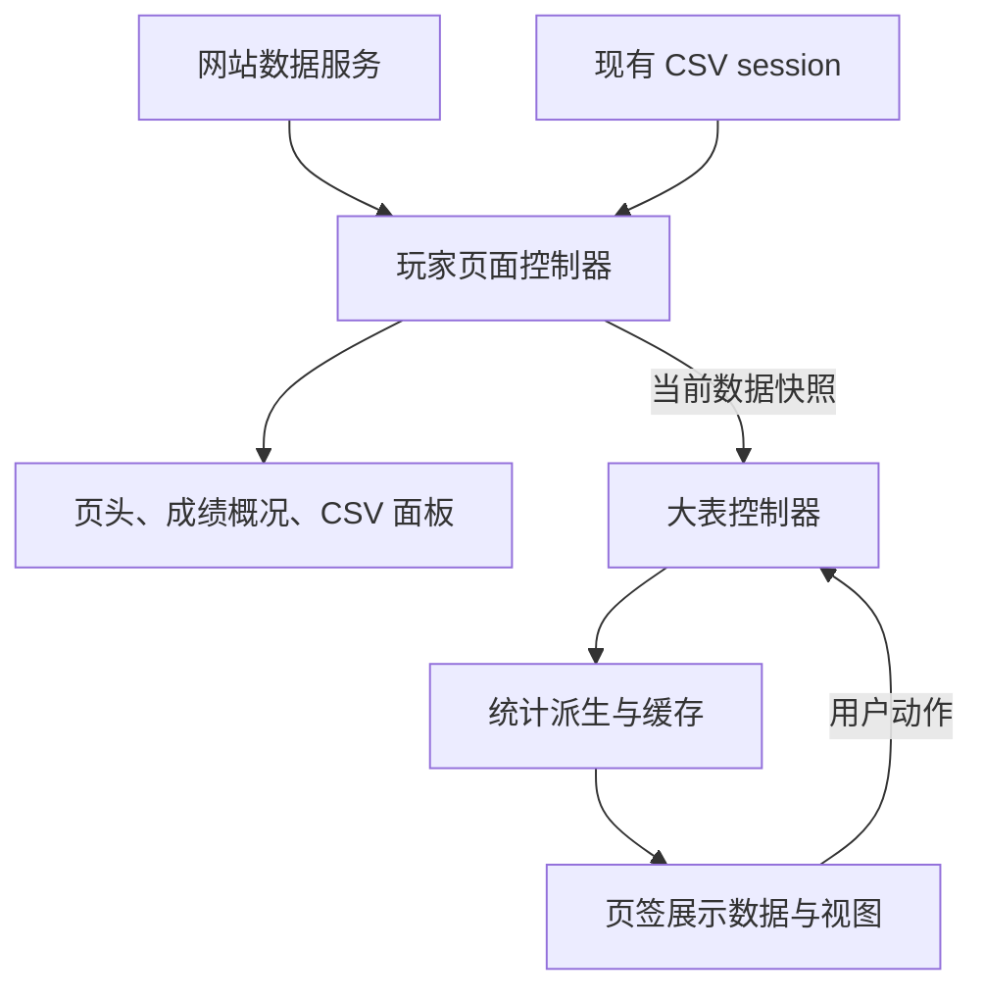

# 玩家统计界面与状态编排分批重构方案

- 编写日期：2026-11-05
- 代码基线：`a2d199f`（第二批重构完成后，版本 1.3.1；方案初稿基于 `ece72de`，GC 修复在 `f49f990`，第一批在 `6457985`）
- 实施进度：统一记录在第 9 节状态表
- 自动检查基线：第一批提交 `6457985` 的 31 个测试文件、427 项测试及三份构建通过
- 用户验收基线：第一批于 2026-11-05 完成真实浏览器验收，包含已随 `f49f990` 交付的 GC 表格全宽布局

## 1. 目标与边界

`analysis-view.ts` 与 `view.ts` 同时处理数据、状态、派生统计、HTML 和异步操作。计划按职责拆分，使一次功能修改只涉及必要模块，并让状态测试能够直接运行而不依赖 DOM。

继续使用 TypeScript、原生 DOM、现有计算模块和数据存储。四批按顺序实施，每批保持可运行、可独立 review 和提交，验收重点是职责与依赖是否清楚。

本轮不调整统计公式、筛选口径、日期规则、复制输出、网络接口、IndexedDB 结构或持久化键；不增加 UI 框架、状态库、通用事件总线或自动跨日刷新功能。新功能和发现的既有口径问题单独处理，避免与结构迁移混在同一批。

现有职责与口径以这些文件为依据：

- [view.ts](../src/features/player-stats/view.ts)：页面启动、网站 / CSV 切换、PB 与前端成绩、加载和销毁。
- [analysis-view.ts](../src/features/player-stats/analysis-view.ts)：大表外壳、工具栏、页签装配及 DOM 交互。
- [analysis-controller.ts](../src/features/player-stats/analysis-controller.ts)、[analysis-data.ts](../src/features/player-stats/analysis-data.ts)、[analysis-tab-data.ts](../src/features/player-stats/analysis-tab-data.ts)：大表状态、参数与锚点编排、统计缓存及当前页签展示数据。
- [csv-session.ts](../src/features/player-stats/csv-session.ts)：CSV 权限、读取、整批提交、取消与版本冲突。
- [analysis.ts](../src/features/player-stats/analysis.ts)、[compute.ts](../src/features/player-stats/compute.ts)、[lsf-history.ts](../src/features/player-stats/lsf-history.ts)：现有统计计算。
- [玩家数据说明](player-stats.md)：产品行为与统计口径。

## 2. 分批总览

| 批次 | 目标 | 主要产物 | 提交边界 |
| --- | --- | --- | --- |
| 1 | 提取独立展示组件与编辑定位 | 共用定阶展示、梁山分展示、参数面板、焦点与吸顶工具 | 搬代码和明确参数，保留现有状态编排 |
| 2 | 提取大表控制器与派生数据 | 分析状态、操作方法、锚点与参数编排、统计缓存 | 大表视图不再直接管理业务状态和异步请求 |
| 3 | 逐页迁移展示数据 | 八个页签视图、与当前展示一致的复制数据 | 八页签及其派生数据一并交付，数据与渲染职责分开 |
| 4 | 提取页面数据源编排 | 玩家页面控制器、成绩展示、CSV 面板、薄页面入口 | 网站与 CSV 生命周期归属明确，保留现有 session |

批次内可以拆成多个小提交。未完成当前批的自动检查和对应浏览器验收时，先完成当前批，再进入下一批。

## 3. 目标结构与依赖

下列新增文件按批次逐步引入，不提前创建空模块。

| 模块 | 职责 |
| --- | --- |
| `view.ts` | 创建控制器与视图、连接订阅、处理入口环境、统一销毁 |
| `player-state.ts` | 页面状态类型，引用 `model.ts` 中的数据快照类型，不依赖 DOM 或具体控制器 |
| `player-controller.ts` | 网站请求、取消、未过审补抓、数据源切换、快照选择与 CSV session 编排 |
| `analysis-state.ts` | 大表状态类型、日期草稿与页签逻辑状态 |
| `analysis-controller.ts` | 执行大表操作，管理参数与锚点异步任务，发布只读分析快照 |
| `analysis-data.ts` | 调用现有计算函数，按明确依赖生成并缓存统计结果 |
| `analysis-tab-data.ts` | 按当前页签生成展示数据及对应复制文本 |
| `analysis-view.ts` | 大表外壳、工具栏和页签装配，将用户动作转交控制器 |
| `ui/rating-view.ts`、`ui/lsf-view.ts` | 共用定阶 HTML、梁山分统计 / 图表 / 流水展示 |
| `ui/settings-panel.ts`、`ui/range-control.ts` | 参数和日期控件的创建、回填、输入及动作通知 |
| `ui/editor-focus.ts` | 吸顶高度、编辑定位、焦点恢复、动画帧和观察器清理 |
| `ui/tabs/*.ts` | 当前页签的展示，不读取存储或执行统计重建 |
| `ui/score-view.ts`、`ui/csv-panel.ts` | PB / 前端成绩展示、CSV 文件关联与读取状态界面 |



依赖规则：

- 控制器和派生层不持有 `HTMLElement`，不调用聚焦、滚动或 HTML 渲染方法。
- 视图接收只读数据和动作回调，不直接写控制器内部状态。
- `analysis-data.ts` 依赖状态类型和计算模块，不反向依赖控制器实现。
- 页面与大表控制器由入口连接，彼此不直接导入；类型放在各自的状态文件中。
- 计算、服务与 CSV session 不导入 UI 模块；共用展示组件通过参数复用，避免概览依赖整个梁山分页签。

### 状态归属

| 状态 | 唯一持有者 |
| --- | --- |
| 网站 / CSV、成绩概况 / 大表、网站进度与错误、当前可用快照 | 玩家页面控制器 |
| PB 软件 / NF 筛选、PB 显示指标、含未过审选项 | 玩家页面控制器的成绩状态 |
| CSV 关联、权限、读取批次、清单版本、上次成功快照 | 现有 CSV session |
| 大表软件 / NF / 日期、当前页签与各页签指标选择 | 大表控制器 |
| 已应用日期、编辑草稿、编辑入口、校验错误 | 大表控制器 |
| 参数与锚点加载状态 | 大表控制器；持久化仍使用现有设置模块 |
| 梁山分展开 / 定位、趋势展示选项等需跨重绘保留的逻辑状态 | 大表控制器中按页签划分的状态 |
| 统计结果与缓存 | 派生层，每个大表实例独立持有 |
| DOM 引用、焦点、尺寸、滚动、复制反馈计时器 | 对应 UI 组件 |

## 4. 所有批次共同保留的行为

### 4.1 统计与数据顺序

1. 大表普通统计保持现有顺序：基础有效记录 → 软件 / NF 筛选 → PB 标记 → 统计 3BV 下限与日期截取。不能先按日期截断再标记 PB。例如上月同一等级、同一 3BV 已有 10 秒，本月 12 秒，选择本月后 12 秒仍不应成为新 PB。
2. 今日成绩继续使用基础有效数据；月年局数、GC 与普通榜单各自保留现有数据集，不统一套用同一个已筛选数组。
3. 梁山分定阶和历史使用自身的完整有效数据；软件 / 只看 NF 不参与，日期用于截取历史时段。保留缺失日期、未来记录和历史重建时钟的现有语义。
4. PB 与大表的 NF 判断继续按现有规则分别处理。PB 软件 / NF 筛选不改变前端成绩两张表的既有统计方式。
5. `markPb()` 会修改 `AnalysisGame`。第一阶段以现有 `analyzeGames()` 完整结果为缓存单位，避免不同筛选在共享对象上反复改写 PB 字段。

### 4.2 数据源、草稿与复制

- 网站与 CSV 保留独立结果。CSV 失败或取消保留旧快照，尚未读取时不展示假空统计；切源后晚到结果不能改回旧数据源。
- 独立 CSV 启动不自动请求网站玩家和网站锚点。其他启动模式继续遵守现有 `autoSiteAnchors` 行为。
- 应用日期才改变已应用范围；校验失败保留草稿，取消恢复入口。离开梁山分页签时丢弃其页内草稿，全局编辑草稿按现有规则保留。
- 数据快照更换时清理旧流水展开 / 定位及未应用草稿，保留现有已应用时段等选项。
- 周、月、年和今日复制从当前展示对应的数据生成；复制不触发展开 / 收起。异步复制完成时不更新已经被替换或销毁的按钮。
- 吸顶、参数展开、日期编辑、错误聚焦和取消后的焦点恢复，均保留已修复行为。

## 5. 第一批：展示组件与编辑定位

### 范围与步骤

1. 将 `ratingOverviewHtml()` 等共用定阶展示迁入 `ui/rating-view.ts`，由概览与梁山分共同引用。
2. 将梁山分统计、阶梯图、事件明细、流水和说明等 HTML 函数迁入 `ui/lsf-view.ts`，继续接收现有 `LsfHistory` / `LsfRange` 等参数。
3. 将参数面板 DOM 创建、输入引用和回填迁入 `ui/settings-panel.ts`。参数修改、保存及锚点请求暂由原 `analysis-view.ts` 提供回调。
4. 将吸顶测量、`revealEditorControl()`、焦点避让与资源清理迁入 `ui/editor-focus.ts`。面板是否正在编辑由外部告知，日期校验仍留在原逻辑中。

组件按用途提供 `root`、`update(props)`、动作回调与 `destroy()`，不传入包含整个旧闭包的通用 context。参数面板不直接执行网站请求或写 localStorage。

本批继续保留外部使用的 `createAnalysisView()`、`update(videos, { csv })` 和 `destroy()` 接口。纯展示函数迁移后，测试直接导入新归属文件；产品入口保持稳定，不长期保留只为旧测试路径存在的转发导出。

### 验收

- [x] 现有定阶、梁山分展示、参数、色板和交互测试通过；计算与保存回调的调用条件不变。
- [x] 页面中部从吸顶入口打开参数 / 日期面板后，编辑区可见且焦点正确；关闭、取消及日期校验失败行为正常（DOM 模拟）。
- [x] 用可控的动画帧队列验证快速开关和销毁会取消旧定位；不只依赖同步执行动画帧的测试桩。
- [x] 关闭页面、收起 iframe 后，观察器、窗口监听和待执行动画帧均由组件释放。
- [x] 独立页与嵌入页的定阶、图表和流水显示一致，无新增页面横向溢出（用户于 2026-11-05 确认真实浏览器验收完成）。

## 6. 第二批：大表控制器与派生数据

### 范围与步骤

1. 引入 `analysis-state.ts`，明确筛选、已应用日期、草稿、参数状态和页签状态的类型。
2. 引入 `analysis-controller.ts`，迁移状态变更、日期校验、参数规范化与保存、锚点请求及失效保护。
3. 引入 `analysis-data.ts`，迁移 `applyFilters()`、历史缓存和统计数据集的生成。渲染函数先通过分析快照读取数据，页签 HTML 在下一批继续拆分。
4. 原 `analysis-view.ts` 创建并订阅控制器，保留对外接口，将输入事件转成明确操作。组件只读快照，不直接修改参数对象或展开集合。

控制器接口应围绕实际动作，最小形式如下；快照不含 DOM 或 HTML：

```ts
interface AnalysisController {
  getSnapshot(): AnalysisSnapshot
  subscribe(listener: (snapshot: AnalysisSnapshot) => void): () => void
  setDataset(dataset: DatasetSnapshot): void
  selectTab(tab: AnalysisTab): void
  setFilters(patch: AnalysisFilterPatch): void
  beginRangeEdit(owner: 'global' | 'lsf'): void
  setRangeDraft(draft: Partial<CustomRange>): void
  applyRange(): CustomValidation
  cancelRangeEdit(): void
  updateSettings(patch: AnalysisSettingsPatch): void
  refreshSiteAnchors(force?: boolean): Promise<boolean>
  destroy(): void
}
```

设置 patch 按现有输入规则规范化，不暴露任意 `setState()`。控制器依赖只通过实际需要的接口注入，例如时钟、锚点读取和设置读写，便于测试状态转换和晚到结果。

### 数据快照与缓存

`DatasetSnapshot` 在本批加入现有 `model.ts`，明确包含数据源、来源身份、内容版本和录像数据，第四批的页面状态直接引用。网站玩家 ID 与 CSV 快照必须能区分；进度和提示变化不增加数据版本。旧 `update()` 接口在大表外壳内适配，第四批再与页面控制器直接连接。

| 输入变化 | 应更新的内容 |
| --- | --- |
| 数据身份 / 内容版本 | 对应统计缓存；重置旧数据的定位与展开状态 |
| 软件 / NF | 普通分析数据集及其统计，完整评分数据保持原语义 |
| 日期范围 / 当前范围签名 | 时段统计，复用完整历史 |
| 锚点 / 评分权重 | 评分与梁山分历史 |
| 3BV 下限 | 普通统计、评分及历史 |
| 色板 | 展示样式，不重建历史 |
| 展开、收起、增加流水显示条数 | 展示状态与相应局部内容 |

历史缓存保留数据、锚点、权重、3BV 下限和重建时钟的依赖。先收拢已有缓存，不为每个指标增加版本计数器；派生结果不允许被消费者修改。

### 验收

- [x] 控制器测试可在没有 document / HTMLElement 的环境下运行。
- [x] 覆盖日期草稿、应用、校验、取消、切页规则，以及数据切换后的定位重置。
- [x] 用相同合成数据核对 PB、今日、月年、评分与梁山分结果；保留第 4 节的不同口径。
- [x] 展开流水和改变显示条数不重建历史；必要参数变化会重建；锚点晚返回与销毁后的结果不写回。
- [x] 独立 CSV 不发生自动网站请求；现有设置键与持久化内容兼容。
- [x] 第一批的吸顶与焦点回归继续通过。

## 7. 第三批：页签展示数据与渲染

### 范围与步骤

页签按以下三组组织，展示数据与渲染作为第三批统一交付：

1. 概览、趋势：迁出 `overviewHtml()`、`trendHtml()`，先明确今日、近期指标、周月年统计与复制数据的归属。
2. 梁山分：连接第一批的展示函数，整理完整历史、时段结果与展开 / 定位状态的展示数据。
3. 榜单、月年、分布、效率、地图：逐页迁出剩余 HTML 函数，复用现有计算结果。

每个页签接收明确类型的展示数据。派生层只聚合当前页签实际需要的内容，避免每次状态变化计算八个页签。

趋势展示数据同时包含周汇总、三级槽位、总计 / 平均、PPP 摘要和对应复制文本。`trend-copy.ts` 负责格式化，预览复用已生成的复制文本；渲染不修改统计缓存，修改复制字段只基于当前展示数据局部更新。

复制事件按周期键与当前展示快照回查。今日复制也读取对应展示结果，避免点击时按另一套筛选或时钟重新统计。复制反馈和相关计时器留在视图中。

### 验收

- [x] 各页签不直接读取 localStorage、执行网络请求或重建历史。
- [x] 同一组数据、参数、日期与时钟下，关键统计值和周 / 月 / 年 / 今日复制文本与基线一致。
- [x] 复制不改变展开状态，切源或重绘后的旧按钮反馈不会回写新视图。
- [x] 选中难度、指标、月份、布局等跨切页状态符合既有行为；数据更新只清理应失效的部分。
- [x] 八个页签在桌面 / 窄屏、浅色 / 深色及嵌入模式下无展示回归（用户于 2026-11-06 确认真实浏览器抽查验收完成）。
- [x] 第一、二批保留的交互与缓存测试继续通过，不用整页 HTML 快照替代行为断言。

## 8. 第四批：页面数据源编排

### 范围与步骤

1. 引入 `player-state.ts`，明确启动模式、网站加载状态、成绩筛选及当前数据快照。
2. 引入 `player-controller.ts`，迁移网站请求、取消、未过审补抓、切源、当前快照选择和 CSV session 编排。
3. 提取 `ui/score-view.ts` 与 `ui/csv-panel.ts`，保留文件选择、输入回填和显示反馈。文件选择器与授权操作继续从用户点击直接触发，结果连同选择上下文交给控制器。
4. `view.ts` 创建控制器与视图、连接订阅，按当前快照身份和版本更新大表。进度或提示变化只更新页面状态，不重新生成分析数据。

网站服务与 CSV session 保持各自接口。保留“网站请求 / 文件选择流程 / CSV 读取批次 / 锚点请求”的独立失效范围，由相应控制器或 session 持有；不合并为一个全局取消版本。

页面控制器负责创建和销毁 CSV session；入口负责创建大表控制器、视图和连接它们的订阅。销毁时先撤销订阅，再停止请求与 session，最后清理 DOM 组件，防止销毁过程中产生新的渲染。

### 验收

- [ ] 网站首次加载、缓存、刷新、取消、缺失明细和未过审补抓保持原行为。
- [ ] 覆盖 CSV 清单恢复、添加、重新关联、移除、刷新成功 / 失败 / 取消；任一失败保留旧完整快照。
- [ ] 覆盖文件选择后切源、读取期间切源、网站 / 锚点晚返回、移除全部以及销毁；旧结果不能自动切回来源或恢复已移除数据。
- [ ] PB 筛选计数、大表样本数、梁山分记录数保持各自归属。
- [ ] 独立 CSV、普通玩家页、站内 iframe 三种启动模式的入口、联网和显隐符合原规则。
- [ ] 切换玩家、离开宿主页、收起 iframe 后，不遗留网络任务、观察器、订阅或定位任务。
- [ ] 原生文件选择 / 授权、实际扩展页面和宿主页 iframe 完成对应环境验收。

## 9. 每批的检查与交付

每批在提交前执行：

```bash
npm run verify
git diff --check
```

自动测试按职责迁移：现有计算与 CSV 测试继续保留，控制器增加状态转换和竞态用例，DOM 测试集中验证动作转发、焦点、复制和销毁。纯 CSS 调整不新增镜像实现的测试。合并或删除重复测试时保留场景对应关系，不以测试数量不变代替覆盖判断。

浏览器验收使用当前用户已验收界面作为参考。每批只重点检查实际触及的链路；涉及 DOM 迁移时覆盖独立页、嵌入页和窄屏，涉及数据源编排时补实际文件授权与读取。DOM 焦点和布局尺寸可直接断言，需要比较观感时再保留截图。本地模拟通过与真实扩展通过分别记录。

每批交付时简要记录：实际迁移模块、接口变更、自动检查、浏览器验收、遗留项和对应提交。记录留在本文件的状态表或提交说明中，避免再建立重复的临时实施文档。

| 批次 | 开发状态 | 验证与提交 |
| --- | --- | --- |
| 1：展示与定位 | 已完成并验收 | 类型检查、31 个测试文件 / 427 项测试、三份构建及 `git diff --check` 通过；用户确认真实浏览器验收完成；随本批提交交付 |
| 2：状态与派生 | 已完成并验收 | 类型检查、32 个测试文件 / 447 项测试、三份构建及 `git diff --check` 通过；用户确认本批真实浏览器抽查完成；随本批提交交付 |
| 3：页签展示 | 已完成并验收 | `npm run verify` 通过（tsc、33 个测试文件 / 451 项测试、三份生产构建）；`git diff --check` 通过；用户确认真实浏览器抽查验收完成；随本批提交交付 |
| 4：数据源编排 | 未开始 | — |

### 第一批交付记录

- 基线：第一批重构以 `f49f990`（GC 表格全宽修复）为起点；GC 修复属于已交付内容，不在本批改动中。
- 展示拆分：定阶总览、梁山分统计 / 图表 / 流水、时段控件分别归入 `ui/rating-view.ts`、`ui/lsf-view.ts`、`ui/range-control.ts`。
- 组件拆分：`ui/settings-panel.ts` 管理参数 DOM、校验和回填，保存、重绘与锚点请求仍由视图回调处理；`ui/editor-focus.ts` 管理吸顶、定位、焦点及观察器 / 动画帧清理。对外 `createAnalysisView()`、`update()`、`destroy()` 接口不变。
- 共用能力：难度文案使用 `model.ts` 的 `LEVEL_LABELS`，HTML 文本转义使用 `shared/ui.ts` 的 `escapeHtml()`。
- 自动验证：类型检查、31 个测试文件 / 427 项测试、三份构建与 `git diff --check` 通过。组件和交互测试覆盖帧取消、焦点与监听清理、参数校验 / 回填及修改 3BV 下限后的重筛和保存。
- 浏览器验收：用户于 2026-11-05 确认本批真实浏览器验收完成，独立页、嵌入页、窄屏及浅色 / 深色检查项已关闭。

### 第二批交付记录

- 基线：第二批以 `6457985`（第一批重构完成）为起点。
- 模块拆分：`analysis-state.ts` 定义状态与快照，`analysis-controller.ts` 持有状态并处理动作、保存与锚点请求，`analysis-data.ts` 负责独立口径的数据集和缓存；控制器不依赖 DOM。
- 视图接线：输入转为控制器动作，渲染直接使用订阅收到的快照。参数和锚点按各自修订号回填；`AnalysisUpdateOptions` 统一公开接口与实现，包含可选的 `csv` 和 `identity`。
- 缓存语义：数据身份 / 内容版本变化重建全部；软件 / NF 只影响普通数据；日期只影响时段数据；锚点、权重、3BV 下限重建历史；色板和展示状态变化复用历史。
- 回归覆盖：保留日期两端连续编辑、切页与锚点异步返回、旧请求失效、数据切换、计算口径及缓存边界测试；身份参数通过真实的公开接口调用进行类型检查。
- 自动验证：类型检查、32 个测试文件 / 447 项测试、三份构建与 `git diff --check` 通过。
- 浏览器验收：用户于 2026-11-06 确认本批真实浏览器抽查完成。

### 第三批交付记录

- 基线：第三批以 `a2d199f`（第二批重构完成）为起点。
- 职责拆分：`analysis-tab-data.ts` 只聚合当前页签；八个页签的 HTML 归入 `ui/tabs/*.ts`，共用格式化、颜色与录像链接归入 `common.ts`；`analysis-view.ts` 保留外壳、工具栏、事件转发与局部交互。
- 展示快照：今日、周、月、年复制按周期键回查当前展示结果；月 / 年预览复用复制文本，修改字段只更新复制内容。周复制文本只保留一份，梁山分明细与定位直接回查当前页签数据。
- 回归覆盖：八页签渲染与存储 / 网络隔离合并验证；保留复制等价性、字段更新复用统计，以及固定「今天」时段跨午夜后修改月 / 年选项、恢复默认和复制原统计日期的交互回归。自动验证结果见上表。
- 浏览器验收：用户于 2026-11-06 确认八个页签的桌面 / 窄屏、浅色 / 深色及嵌入模式真实浏览器抽查验收完成。
- 提交与后续：第三批随本次提交交付；页面数据源编排与真实来源身份留待第四批。本计划保留至四批完成。

四批完成后，将稳定职责更新到 README 项目结构；产品行为说明继续维护在 `docs/player-stats.md`。清除已完成 TODO 和过时迁移说明，本计划及其入口也随整理移除；不把开发方案记作已实现功能或发布记录。
